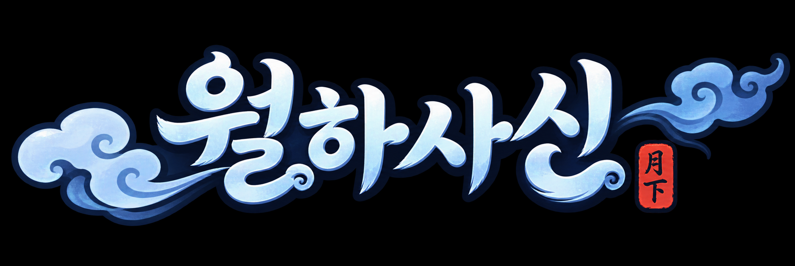

# Python 게임 제작_팀과제_Random Tower Defense_월하사신

<p align="center">
  
</p>

설명: 
월하사신은 청룡, 백호, 주작, 현무 네 사신을 소환하고 배치하여 몰려오는 잡귀로부터 결계를 지키는 Python 기반 랜덤 타워 디펜스 게임입니다.

플레이어는 한정된 금화를 활용해 사신을 소환·강화·배치하고, 소동마다 달라지는 적의 공격에 대응해야 합니다.

Python으로 게임 규칙과 전투 로직을 구현하고, Pygame으로 게임 화면과 사용자 인터페이스를 구성했습니다.

장르: 랜덤 타워 디펜스 / 자동 전투

🕒 개발기간: 2026.10.12. ~ 2026.10.20.


## 1. 설치 및 실행

### 1. 환경 설정
```bash
# Python 3.10 이상 필요
python -m venv venv # 가상 환경 생성
pip install -r requirements.txt
```

### 2. 게임 실행
```bash
python main.py
```

### 3. UI 없이 게임 시뮬레이션 (밸런스 테스트)
```bash
python scripts/balance.py
```


## 2. 기술 스택


## 3. 프로젝트 구조

- **루트**
  - `main.py`: 실행 진입점 (게임 루프, 화면·입력·엔진 연결)
  - `config.py`: 화면 크기, 게임 규칙, 색상 등 공통 상수
  - `requirements.txt`: 필요한 라이브러리 목록
  - `역할분배.md`: 팀원별 역할 분담 및 파일 구조 문서

- **game/**: 게임 로직 (Pygame 의존하지 않음)
  - `engine.py`: 게임 상태 관리 및 루프
  - `state.py`: 공통 게임 상태 정의
  - `tower.py`, `combat.py`: 사신(타워) 및 전투 시스템
  - `enemy.py`, `wave.py`: 악귀(몬스터) 및 소동(웨이브) 시스템
  - `economy.py`, `actions.py`: 경제 및 행동 관리
  - `map.py`: 맵, 경로, 사신 배치 슬롯 데이터

- **display/**: UI 및 렌더링 (Pygame 의존)
  - `renderer.py`: 화면 그리기 (게임판, 사이드 패널, 팝업)
  - `ui.py`: UI 요소 (버튼, 패널)
  - `input_handler.py`: 마우스/키보드 입력 처리 및 팝업 상태 관리
  - `map_projection.py`: 그림 맵의 좌표를 화면 좌표로 변환 (화면 배치와 게임 좌표 분리)
  - `render_sizes.py`: 사신·악귀·보스의 화면 크기와 위치 보정값
  - `sprite_animation.py`: 사신 4종(청룡·백호·주작·현무) 대기/공격 애니메이션
  - `enemy_animation.py`: 일반 악귀 이동 애니메이션
  - `boss_animation.py`: 보스 이동 애니메이션
  - `effect_animation.py`: 공격 이펙트 애니메이션

- **assets/**: 이미지 리소스
  - `logo.png`: 프로젝트 로고
  - `backgrounds/`: 게임판 배경 이미지 (`map_background.png`이 실제 게임판)
  - `sprites/`: 사신 4종, 일반 악귀, 보스 스프라이트 이미지

- **data/**: 게임 데이터 및 이미지
  - `map.json`: 맵 이미지 기준 경로와 사신 배치 슬롯 좌표
  - `towers.json`: 타워 능력치
  - `enemies.json`: 몬스터 정보
  - `stages.json`: 소동(스테이지)별 악귀 수·체력, 보스 정보
  - `boss_roster.png`: 보스 6종 초상화 이미지 (전투 중 사이드 패널에 표시)
  - `map.grid-legacy.json`: 이전 격자 방식 맵 데이터 (현재 코드에서는 사용하지 않음, 참고용)

- **scripts/**: 시뮬레이션 및 검증 도구
  - `balance.py`: 자동 게임 실행 및 통계 (옵션: `--games`, `--stages`, `--output`)
  - `BALANCE_GUIDE.md`: 맵·밸런스 도구 사용 가이드
  - `capture_map_debug.py`: 맵 검증용 오버레이 화면 캡처

- **results/**: 밸런스 시뮬레이션 결과 (CSV, JSON)

- **tests/**: 단위 및 통합 테스트
  - 게임 로직: `test_engine.py`, `test_economy.py`, `test_combat.py`, `test_wave.py`, `test_map.py`, `test_rewards.py`, `test_slow_fields.py`, `test_speed.py`, `test_balance.py`
  - 화면·애니메이션: `test_ui.py`, `test_boss_animation.py`, `test_enemy_animation.py`, `test_effect_animation.py`, `test_effect_tracking.py`


## 4. 팀원

| 박건희 | 박현규 | 오승아(팀장) | 윤재빈 | 이서진 | 이승연 |
| --- | --- | --- | --- | --- | --- |
| [@Gunhee](https://github.com/byvt1234) | [@Hyeonkyu](https://github.com/Park-HyeonKyu2) | [@Seongah](https://github.com/OhSeungAh2) | [@jeabin](https://github.com/Jeabin90) | [@Seojin](https://github.com/leeseojin-dev) | [@Seungyeon](https://github.com/angela5825) |
